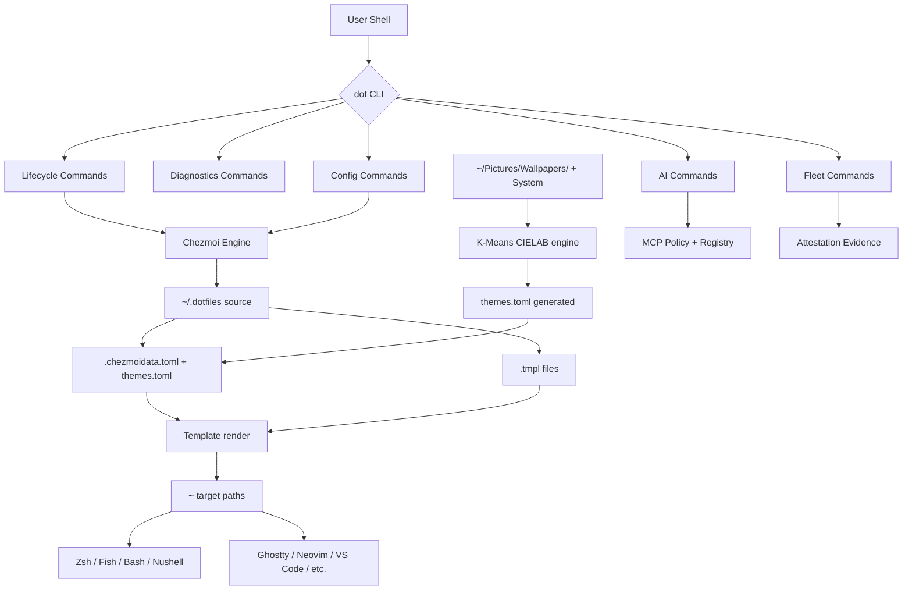

# Architecture

`.dotfiles` is composed of four loosely coupled subsystems, coordinated by a single command-line interface.

## The Four Subsystems

### 1. Templating Engine — Chezmoi

[Chezmoi](https://chezmoi.io) reads the source directory (`~/.dotfiles/`; its `.chezmoiroot` points chezmoi at the `defaults/` subdirectory), renders templates using data from `defaults/.chezmoidata.toml`, and writes the results to the target paths in `$HOME`.

Every file in the source directory follows chezmoi naming conventions:

| Prefix / Suffix | Effect |
|:---|:---|
| `dot_` | Deployed with leading `.` (`dot_zshrc` → `~/.zshrc`) |
| `executable_` | Sets `+x` permission on the destination |
| `private_` | Sets `0600` permission on the destination |
| `.tmpl` | Processed as a Go template with chezmoi data |
| `run_onchange_` | Script runs when the target changes |
| `run_before_` | Script runs before apply |
| `run_after_` | Script runs after apply |

### 2. Runtime Management — Mise and Nix

**Mise** ([mise.jdx.dev](https://mise.jdx.dev)) manages per-user language runtimes and CLI tools. The tools pinned in `~/.config/mise/conf.d/00-dotfiles.toml` are installed to `~/.local/share/mise/installs/`, activated by PATH shimming. No system-level packages are touched.

**Nix Flakes** (`nix/flake.nix`) provide strictly reproducible builds when Mise's approximate semver-pinning is insufficient — for example, for declaring an entire system via Home Manager.

### 3. The `dot` CLI

`dot` is the entry point for all lifecycle operations. It is a Bash script (`bin/dot`) that resolves each command from the command table and hands it to the domain's plugin: `plugins/<domain>/dot-<domain>` receives the words after the domain (ADR-020). A few routes still run modules in `scripts/dot/commands/`.

A plugin entry can be run directly when needed:

```sh
~/.dotfiles/plugins/doctor/dot-doctor status
# equivalent to:
dot doctor status
```

Commands take the form `dot <domain> [object] <verb>`. `dot help` groups the 17 domains (see [dot CLI Reference](../03-reference/01-dot-cli.md)):

- **Configuration**: `config`, `shell`, `theme`, `tool`
- **Sessions**: `session`, `top`
- **Agents**: `ai`, `agent`, `mcp`
- **System**: `system`, `doctor`
- **Trust & hosts**: `secret`, `security`, `attest`, `fleet`
- **Platform**: `cli`, `ui`

Shortcuts cover the daily verbs: `dot apply`, `dot sync`, `dot diff`, `dot status`, `dot edit`, `dot cd` and `dot update`.

### 4. Secrets and Attestation

Secrets are encrypted at rest using **Age** (modern file encryption) with **SOPS** (YAML-aware envelope) or `chezmoi encrypt`. chezmoi's age identity lives at `~/.config/chezmoi/key.txt` (the default `chezmoi init` offers); SOPS reads its keys from `~/.config/sops/age/keys.txt`.

Attestation (`dot attest show`) produces machine-readable, unsigned JSON recording:

- Generation time and dotfiles version
- Platform (runtime, host OS, architecture, hostname)
- Git signing configuration (format, signing key, allowed signers file, `merge.verifySignatures`)
- The active agent profile, the agent profiles and the agent card
- Governance registries (policy bundles, model and prompt registries)
- MCP posture: the `mcp-doctor` summary, the MCP policy and the MCP registry

See [Trust Model](02-trust-model.md) for the full threat model.

## Data Flow



## Startup Performance Model

Shell startup is optimized via a three-tier caching strategy:

1. **Bake-at-apply-time** — values computed once during `chezmoi apply` (HOSTNAME, platform, OS version) are written directly into config files, avoiding subshells at startup.
2. **`_cached_eval` pattern** — slow initializers (mise, zoxide, atuin, starship) write their output to `~/.cache/zsh/<label>.zsh` (Bash: `~/.cache/bash/<label>.bash`). Subsequent shells `source` the cache. Cache is invalidated when the binary is newer than the cache or its resolved path changes.
3. **Lazy loading** — heavy layers load on first invocation via shell function stubs: `thefuck` does, and the zsh `_dot_lazy` helper wraps others (nvm, pyenv, conda) the same way.

`dot doctor perf show` measures startup against a 250 ms target by default (`DOTFILES_PERF_TARGET_MS`; see [Performance Reference](../03-reference/01-dot-cli.md#performance)).

## Per-Machine Profiles

The `machine` key (empty in `defaults/.chezmoidata.toml`, set per host in `~/.config/chezmoi/chezmoi.toml`) selects a `[machines.<name>]` preset from `defaults/.chezmoidata/hardware.toml` (`macbook-t2`, `surface-pro`, `geekom-a9`); with no machine set, the `[hardware]` defaults apply. A preset sets:

- `profile`, `scale` and `hidpi`
- `touchscreen`, `touchpad`, `touchpad_accel` and `touchpad_accel_profile`
- `max_refresh`, `gpu` and `keyboard_layout`
- `output_name` and `output_mode` (the Niri output)

Feature flags such as `features.niri` are separate: they live under `[features]` in `.chezmoidata.toml` and are overridden per host under `[data.features]`.

A single source tree deploys correctly to a MacBook, a Surface, a Linux desktop, and a WSL2 session — each rendering a platform-appropriate config.

## Trust Boundaries

| Boundary | Trusted | Untrusted |
|:---|:---|:---|
| Source tree | Your Git history, signed commits | Unverified pull requests |
| Secret store | `~/.config/chezmoi/key.txt`, `~/.config/sops/age/keys.txt` | Environment variables, cloud storage |
| Attestation evidence | A record that passes `dot attest verify` | A record nobody has verified |
| Template data | `.chezmoidata.toml` | User-provided template input |

Branch protection on `main` requires signed commits, gitleaks scans every push, and `dot attest verify` checks an attestation record in a WebAssembly sandbox. Attestation records themselves are not signed or hash-chained.

## Next

- [Trust Model](02-trust-model.md) — detailed threat model and verification procedures
- [Theme Engine](03-theme-engine.md) — K-Means CIELAB pipeline
- [Fleet Architecture](04-fleet.md) — multi-host deployment model
