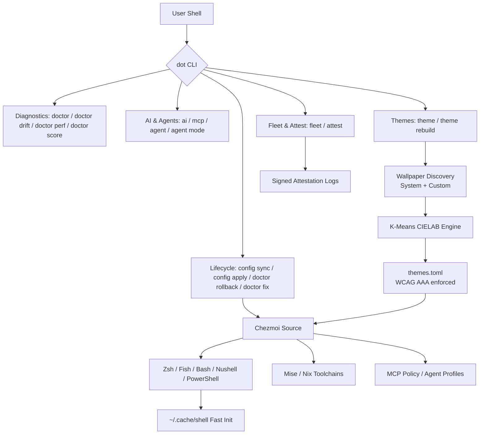

<!-- Moved from the README (wave 2, R2.3); the text is unchanged. -->

# The `dot` CLI tour

Commands are spelled `dot <domain> [object] <verb>` (ADR-020), with
the shortcuts `dot apply`, `sync`, `diff`, `status`, `edit`, `cd` and
`update` for the daily loop; the tables below group them by intent.
`dot help` shows the overview, `dot help all` the full reference,
`dot help <keyword>` filters it. The
[command index](../../../docs/manual/command-index.md) is generated from the
plugin manifests (through the command table) and checked in CI.

## Start here

| | |
|:---|:---|
| `dot config init <user>` | Bootstrap any GitHub user's dotfiles repository through this harness |
| `dot sync` | Apply dotfiles to this machine (`--pull` to fetch first, `--check` to preview) |
| `dot doctor` | Check the environment and surface issues |
| `dot help tour` | Open the guided tour |
| `dot agent context apply` | Sync `CLAUDE.md` → `AGENTS.md` and every harness stub |
| `dot fleet apply` | SSH out to every host in `~/.config/dotfiles/fleet.toml` |
| `dot cli list --available` | Browse reusable dotfile modules from the registry |

## Daily use

| | |
|:---|:---|
| `dot status` / `dot diff` | Show local drift; preview pending changes |
| `dot edit` / `dot config add` | Open the source directory; add a file to the source |
| `dot system update` | Update toolchains, plugins, and dotfiles |
| `dot config save` | Generate an AI commit message from the staged diff |
| `dot help` | Find commands by keyword |

## Inspect and repair

| | |
|:---|:---|
| `dot doctor fix` | Auto-fix tools, chezmoi drift, and broken symlinks |
| `dot doctor rollback` | Return to a previous known-good state |
| `dot attest export` | Export workstation evidence |
| `dot config export` | Create an offline tarball of the dotfiles environment |

## AI and agents

| | |
|:---|:---|
| `dot ai` | AI tools cockpit — run, chat, install, serve a local gateway, cost |
| `dot mcp` | Inspect MCP policy and registry |
| `dot agent mode` | Show or set the agent profile (ask / plan / apply / audit) |
| `dot agent` | Agent metadata, logs, checkpoints, conformance |
| `dot ai pattern` | List bundled AI patterns (architect, hardener, refactor) |

## Configuration commands

| | |
|:---|:---|
| `dot theme` / `dot theme rebuild` | Switch theme or regenerate from wallpapers |
| `dot tool` | Managed tool versions (list, install, update, remove, set, export) |
| `dot config profile` | Show or switch the active profile |
| `dot secret` | Edit, show, set, list, export encrypted secrets |
| `dot theme font install` | Install or patch Nerd Fonts |

## Fleet and performance

| | |
|:---|:---|
| `dot fleet` | Multi-node status, drift, events, namespace |
| `dot doctor perf show` | Measure shell startup |
| `dot doctor score` / `dot security score show` | Health and security scorecards |
| `dot doctor status` | Live dashboard for caches and tool state |

Full reference: [`docs/reference/UTILS.md`](../../../docs/reference/UTILS.md)
· manual chapter:
[`docs/manual/03-reference/01-dot-cli.md`](../../../docs/manual/03-reference/01-dot-cli.md)
· `man dot` after install.

<b>Architecture</b>

Root layout: `bin/` (dispatcher), `lib/dot/`
(shared bash library), `plugins/` (one plugin per `dot` domain),
`defaults/` (the chezmoi source tree, via `.chezmoiroot`), `scripts/`
(runtime scripts), `tools/` (repo-only ops), `install/` (opt-in
provisioning and migration scripts), `pkg/` (packaging channel
templates). The
map of every top-level path, with the history of the reorganisation
that produced it, is [`docs/STRUCTURE.md`](../../../docs/STRUCTURE.md); the
contributor-facing
design is
[`docs/ARCHITECTURE.md`](../../../docs/ARCHITECTURE.md).

